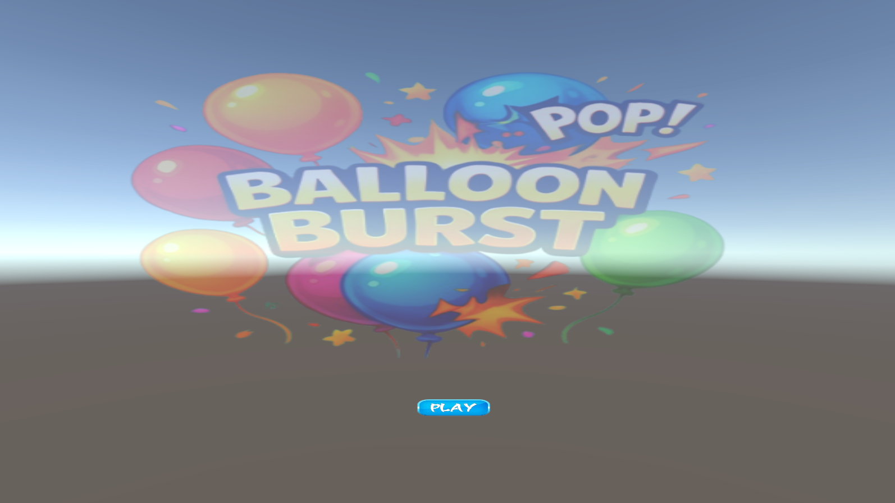
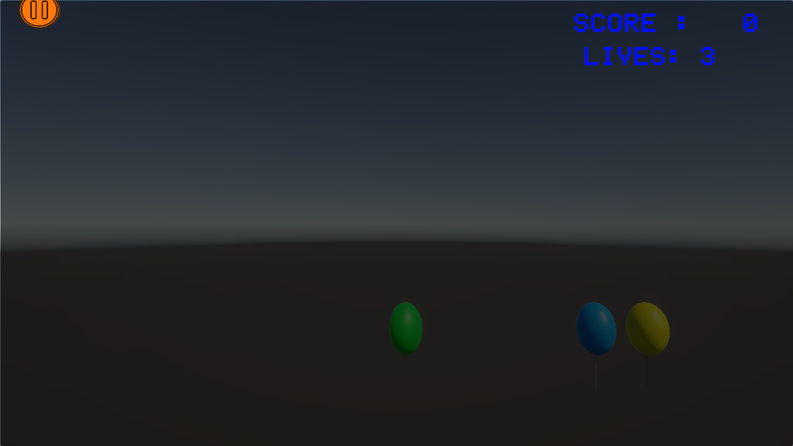
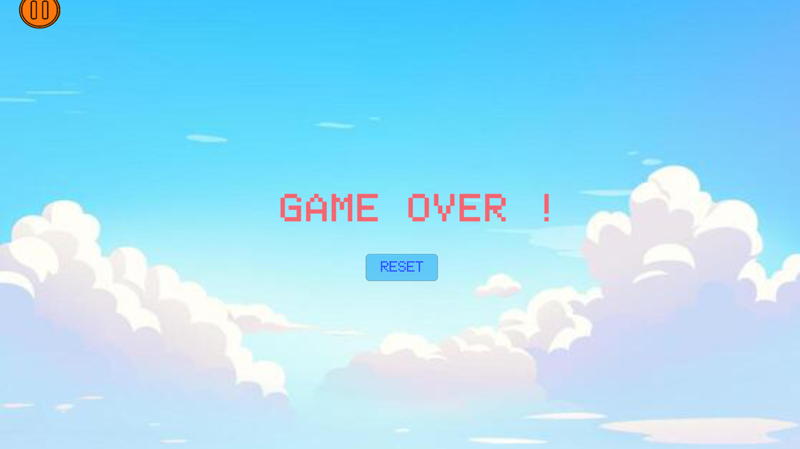

# 🎈 Balloon Bursting Game

**A physics-based 3D clicker game built with Unity 6.3 LTS.**


## 📖 About the Project

**Balloon Bursting** is a lightweight, interactive 3D game that demonstrates **physics-based raycasting**, **UI state management** and **dynamic object spawning** in Unity.

Balloons float upwards through the scene. Pop them with your mouse before they escape, keep an eye on your lives, and aim for the highest score!

This is a **fully open-source project**. You are free to play it, study it, modify it and contribute to it.

### What you can learn from this project

- Detecting clicks on 3D objects with raycasting
- Spawning and destroying objects at runtime
- Managing game states (Start, Gameplay, Game Over) with multiple UI canvases
- Building a simple score and lives system
- Playing sound effects with `AudioSource`
- Publishing a Unity game as a standalone Windows build

---

## 🎮 Key Mechanics

| Mechanic | How it works |
|---|---|
| 🎯 **Pop and Score** | Left-click a balloon with the mouse cursor to pop it. A burst sound plays and your score goes up by **+1**. |
| ❤️ **Lives** | You start with **3 lives**. |
| ⚠️ **Penalty** | If a balloon escapes the camera's view, you lose **1 life** and your score decreases by **-1**. |
| 💀 **Game Over** | When all 3 lives are gone, gameplay stops and the **Try Again / Restart** screen appears. |
| ⏱️ **Timer** | The gameplay screen shows a timer along with your score and remaining lives. |

---

## 🖼️ Game Interface

The game uses a **multi-canvas state management system** to move smoothly between screens.

### 1. Start Menu

The landing screen that waits for the player to begin.

<p align="center"></p>

### 2. Gameplay and Life UI

The active game state with floating balloons, the current score, the timer and your remaining lives.

<p align="center"></p>


### 3. Game Over

Shown when all lives are used up, with the Try Again / Restart option.

<p align="center"></p>


---

### 🚀 Coming Soon on Platforms

| Platform | Status |
|---|---|
| 🪟 Windows (.exe) | 🔜 Coming soon |
| 🍎 macOS | 🔜 Coming soon |
| 🐧 Linux | 🔜 Coming soon |
| 📱 Android | 🔜 Coming soon |
| 🌐 WebGL (browser) | 🔜 Coming soon |

---

## 🛠️ Tools and Technologies

| Tool | Purpose |
|---|---|
| **Unity 6.3 LTS** | Game engine and scene editor |
| **Unity Hub** | Installing and managing Unity versions and projects |
| **C#** | Game logic and scripting |
| **Unity UI (Canvas)** | Start Menu, Gameplay and Game Over screens |
| **Physics Raycasting** | Detecting mouse clicks on balloons |
| **AudioSource** | Burst sound effect |
| **Git and GitHub** | Version control and collaboration |

---

## 📋 Requirements

### To play the game

| Requirement | Details |
|---|---|
| Operating system | Windows |
| Input | Mouse |
| Installation | None. Just run the `.exe` file. |

### To develop or modify the game

| Requirement | Details |
|---|---|
| Unity Hub | Latest version |
| Unity Editor | **Unity 6.3 LTS** (Unity Hub prompts you to install it if missing) |
| Git | To clone the repository and manage branches |
| Code editor | Visual Studio, VS Code or JetBrains Rider (any C# editor) |

---

## 💻 Developer Setup

Follow these steps to view the source, modify the game or build it yourself.

### 1. Clone or download

```bash
git clone https://github.com/yourusername/balloon-bursting.git
```

Or download the repository as a ZIP file and extract it to a folder.

### 2. Open in Unity Hub

1. Open **Unity Hub**.
2. Click **Add** (or **Open** → **Add project from disk**).
3. Select the folder where you cloned or extracted the project.

### 3. Use the correct Unity version

This project requires **Unity 6.3 LTS**. If it is not installed, Unity Hub will offer to download it.

### 4. Play in the Editor

1. Open `Assets/Scenes/`.
2. Double-click **`MainScene`**.
3. Press the **Play** button at the top of the editor.

### 5. Build a Windows executable (optional)

1. Go to **File → Build Profiles** (or **Build Settings**).
2. Select **Windows** and add `MainScene` to the scene list.
3. Click **Build** and choose an output folder.

---

## 🤝 How to Contribute

This is a **fully open-source project** and every kind of help is welcome: fixing bugs, improving the UI, adding features, improving documentation or testing.

### Ways to contribute

- 🐛 **Report bugs** by opening an issue with steps to reproduce
- 💡 **Suggest features** by opening an issue with the idea and why it helps
- 🎨 **Improve the UI**, art or sound
- 💻 **Fix bugs or add features** with a pull request
- 📚 **Improve documentation**
- 📦 **Help build** the macOS, Linux, Android and WebGL versions

### Contribution workflow

1. **Fork the repository.** Click the **Fork** button at the top right of this page.
2. **Clone your fork** and open it in **Unity 6.3 LTS** using the Developer Setup above.
3. **Create a branch** for your work:
   ```bash
   git checkout -b feature/AmazingFeature
   ```
4. **Make your changes** in the code or scene, and test them in the Unity Editor.
5. **Commit** with a clear message:
   ```bash
   git commit -m "Add some AmazingFeature"
   ```
6. **Push** to your fork:
   ```bash
   git push origin feature/AmazingFeature
   ```
7. **Open a Pull Request** against the `main` branch and describe what you changed and why.
8. **Review and merge.** The maintainers test your changes in Unity. If everything runs properly and fits the project, it is merged into `main`.

### Contribution guidelines

- Keep each pull request focused on one change.
- Test your change in the Unity Editor before submitting.
- Do not commit the `Library/`, `Temp/`, `Logs/` or `obj/` folders (use the Unity `.gitignore`).
- Use clear, readable C# with meaningful names.
- Include screenshots or a short description for UI changes.
- Be respectful in issues and reviews. Please read our **[Code of Conduct](CODE_OF_CONDUCT.md)** before contributing.

---

## 📜 License

This project is released under the **Apache License**. You are free to use, copy, modify, merge, publish and distribute it, with credit to the original authors. See the [LICENSE](LICENSE) file for details.

---

## 🌟 Contributors

Thanks to everyone who has helped build this project!

<a href="https://github.com/DeverGuy/balloon-bursting/graphs/contributor">
  
</a>

---

<div align="center">

**If you enjoyed the game, please give the repository a ⭐ star!**

</div>
